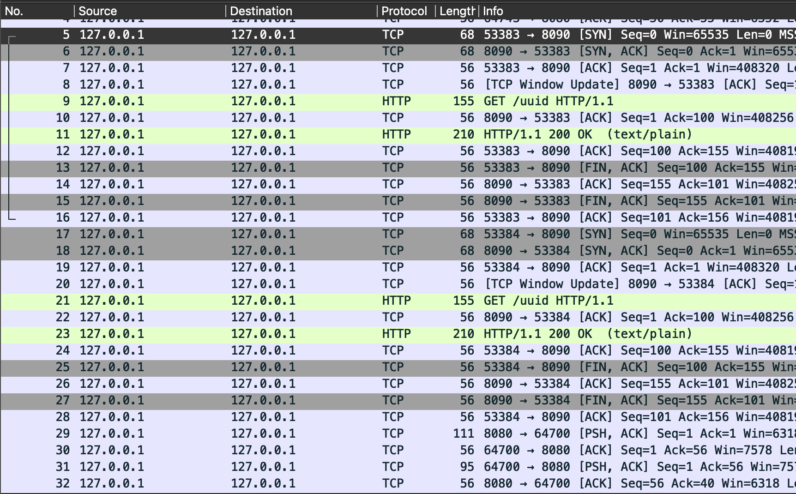
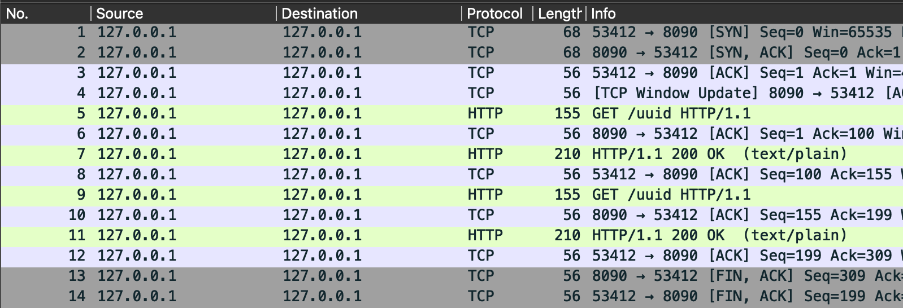
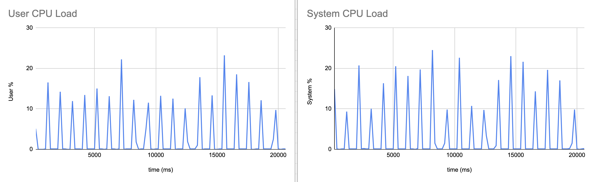
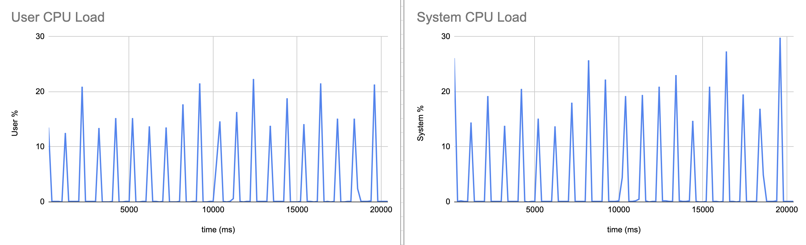
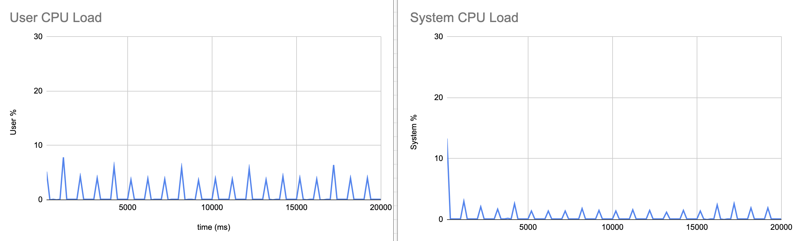

## Background
While I was developing my [ChatPilfer](https://github.com/perihwk/chatpilfer) hacking tool I found myself needing to make some modifications to the default Go HTTP Transport. This post marks the beginning of looking at the Golang HTTP Transport and what behaviors I found that were interesting and worth exploring further. Today we are starting with the `MaxIdleConnsPerHost`, its behavior in a concurrent environment, and how that can impact scaling.

HTTP connection pooling can be a great boon to application performance. There is a real cost required when setting up a new HTTP connection. First dealing with DNS, then a TCP handshake, then probably a TLS handshake, and then finally the packets are allowed to flow. So once that connection is established we don't want to have to go through that same process over and over again when talking to the same service. Thus connection pooling comes in where pooled connections are kept idle so that they can be reused for the next request to that same host, or until the connection reaches its `IdleConnTimeout` and is closed.

## Source Review
I like to begin a research topic by looking at the source code when it is available so there will be references to the Go source for Go 1.27 throughout.

The `http.DefaultTransport` allows 100 idle connections as defined by [MaxIdleConns](https://github.com/golang/go/blob/go1.27.3/src/net/http/transport.go#L211) however the [MaxIdleConnsPerHost](https://github.com/golang/go/blob/go1.27.3/src/net/http/transport.go#L216) defaults to two connections per `connectMethodKey`. What are these idle connections and how are they stored? To answer that let's dig into the codebase a little bit.

To start, the `http.Transport` struct defines many idle connection related fields but we are specifically interested in the idle connection pool `idleConn` which is a map with a key (`connectMethodKey`) describing the server host, and has a value (`[]*persistConn`) of a slice of idle connections.
```go
type connectMethodKey struct {
	proxy, scheme, addr string
	onlyH1              bool
}

type Transport struct {
	idleMu       sync.Mutex
	closeIdle    bool                                // user has requested to close all idle conns
	idleConn     map[connectMethodKey][]*persistConn // most recently used at end
	idleConnWait map[connectMethodKey]wantConnQueue  // waiting getConns
	idleLRU      connLRU
	...
}
```

So we create a new request and our Transport looks for a matching idle connection in `idleConn` via [queueForIdleConn](https://github.com/golang/go/blob/go1.27.3/src/net/http/transport.go#L1241). Inside this function the Transport finds the available connections using the connectMethodKey and checks to make sure that the connection has not been closed since being put into the pool. If it is an HTTP/1.1 connection the conn is pulled out of the pool and returned to the requester to use. However for HTTP/2 it is left in there because multiple requests can be multiplexed over an individual conn. If a connection is not available in the pool then `queueForIdleConn` returns false and the Transport immediately begins dialing a new connection. But the Transport also puts the request in the `idleConnWait` pool and if an idle connection becomes available before the dial is completed then the request will switch to using that idle connection. The dialed connection is then put into the idle pool.

Once a request is completed the connection gets put back into the pool using the [tryPutIdleConn](https://github.com/golang/go/blob/go1.27.3/src/net/http/transport.go#L1129) function. First this function looks at the `idleConnWait` pool and if there is a request waiting for a connection there then it immediately hands that request the connection. Next it checks that the `idleConn[connectMethodKey]` does not already have `MaxIdleConnsPerHost` connections and then inserts the connection back into the idle pool to be reused in the future. So for example the `DefaultMaxIdleConnsPerHost=2` which means if there is already 2 idle connections for your connectMethodKey the connection will be closed and not put into the pool. Furthermore if `MaxIdleConns` has already been reached across all keys then the least recently used idle conn (tracked by `idleLRU`) is evicted. If a connection is not put into the pool then it will enter a `TIME_WAIT` state until the kernel returns the port to the available pool. Additionally once the `IdleConnTimeout` fires the Transport will close the connection as well and remove it from the pool.

## Behavioral Analysis
Idle connections allow you to not need to go through the entire three-way handshake again on subsequent requests. We can see this when viewing with Wireshark while running a basic program using a Transport with `MaxIdleConnsPerHost=-1`.
```go
package main

import (
	"fmt"
	"io"
	"log"
	"net/http"
	"time"
	"uuid"
)

func get_uuid(httpClient *http.Client) {
	resp, err := httpClient.Get("http://127.0.0.1:8090/uuid")
	if err != nil {
		log.Fatalln(err)
	}
	defer resp.Body.Close()

	body, err := io.ReadAll(resp.Body)
	if err != nil {
		log.Fatalln(err)
	}

	fmt.Printf("%s", string(body))
}

func server() {
	http.HandleFunc("/uuid", uuid_gen)
	http.ListenAndServe(":8090", nil)
}

func uuid_gen(w http.ResponseWriter, req *http.Request) {
	fmt.Fprintf(w, "%s\n", uuid.New().String())
}

func main() {
	go server()
	time.Sleep(1 * time.Second) // give server a chance to come alive
	httpClient := &http.Client{
		Transport: &http.Transport{MaxIdleConnsPerHost: -1},
	}
	get_uuid(httpClient)
	get_uuid(httpClient)
}
```


However if I allow the IdleConn pool to be used normally and then perform the same request back to back we can clearly see the handshake is not required for the second request. This is the IdleConnectionPool at work saving us cycles.

```go
package main

import (
	"fmt"
	"io"
	"log"
	"net/http"
	"sync"
	"time"
	"uuid"
)

func get_uuid() {
	resp, err := http.Get("http://127.0.0.1:8090/uuid")
	if err != nil {
		log.Fatalln(err)
	}
	defer resp.Body.Close()

	body, err := io.ReadAll(resp.Body)
	if err != nil {
		log.Fatalln(err)
	}

	fmt.Printf("%s", string(body))
}

func server() {
	http.HandleFunc("/uuid", uuid_gen)
	http.ListenAndServe(":8090", nil)
}

func uuid_gen(w http.ResponseWriter, req *http.Request) {
	fmt.Fprintf(w, "%s\n", uuid.New().String())
}

func main() {
	go server()
	time.Sleep(1 * time.Second) // give server a chance to come alive
	for {
		var wg sync.WaitGroup
		for range 2 {
			wg.Go(func() {
				get_uuid()
			})
		}
		wg.Wait()
	}
}
```



The next interesting part of the idle connections is the `MaxIdleConnsPerHost` which determines how many idle connections are kept in the idle conns pool for each host:port combo. The easiest way to see connections being closed is to use netstat to monitor the number of ports in a `TIME_WAIT` state. We won't get into all the phases of a port as it is being used but the gist of it is that after you use a port it gets returned to the kernel and the kernel puts it in timeout for a predetermined period of time to ensure that it is fully done receiving requests and then it will return it to the available pool.

```sh
while true; do clear; netstat -n -p tcp; sleep 1; done
```

If we only allow two concurrent requests to happen at a time we can see that we can rapidly do thousands and thousands of requests without any issue.


However if we bump the number of concurrent requests allowed up to 3 then we can see our local ephemeral pool quickly becoming fully saturated with extra connections until the program errors out. All those ports sitting in a `TIME_WAIT` state are connections that our Go program has closed but are still being held in timeout by the kernel.

```go
	for {
		var wg sync.WaitGroup
		for range 3 {
			wg.Go(func() {
				get_uuid()
			})
		}
		wg.Wait()
	}
```


This is a pretty egregious example and would be quite easy to track down because we are essentially just spamming our host until we exhaust the local ephemeral ports. However this can become significantly harder to replicate and track down if there is just a little bit of latency involved. Take for instance a scenario where our server has to do some work (database lookup, RPC call, its own web request, etc) and the `uuid_gen` function instead takes 1ms to respond.

```go
func uuid_gen(w http.ResponseWriter, req *http.Request) {
	time.Sleep(1 * time.Millisecond) // simulate a slow response
	fmt.Fprintf(w, "%s\n", uuid.New().String())
}
```


Eventually we do still timeout however it takes significantly longer. Ironically the worse our application performs the more stable it becomes because the time it takes for the request to return means that the port is stranded into the `TIME_WAIT` pool slower and previous ports have a chance to be returned to the kernel. If we bump the wait up to a full second then we can actually see the number of ports sitting in the `TIME_WAIT` state levels out around 30 but never gets anywhere near port exhaustion because on macOS ports are only left in `TIME_WAIT` state for 30 seconds before being returned to the kernel.


## CPU Impact
So we know that this `idleConn` pool is helping us reuse connections which can protect our bad program from exhausting its local ephemeral port pool and crashing. But most programs probably aren't exhausting local ports they are instead seeing spikes in CPU usage that result in premature scaling of the application. Let's take a look at what sort of pressure neglecting our `idleConn` pool can put on the CPU.

To do this I created a CPU sampler program that will look at the user and sys CPU load every 200 ms. In order to avoid port exhaustion errors I made it so that only 200 requests will happen concurrently which gives plenty of time for old ports to be returned to the kernel before new ones get put into the `TIME_WAIT` state. Additionally I made it so the server is split out into its own program and it waits a full second before returning a response. The sampler code is in [cpu.go](cpu.go).

Then I did three separate runs the first of which with no `idleConn` pool at all so every single request requires setting up a new connection and doing the full handshake. Then the second run is with the default pool size of 2 but still with 200 concurrent requests so CPU still has to set up 198 new connections each run. Finally I did an appropriately sized `idleConn` pool where I set both `MaxIdleConnsPerHost` and `MaxIdleConns` to 200.

I mapped both the user and system loads because just doing user % doesn't actually show all the work the kernel has to do for the process. For example setting up the socket, the connection, read / write to the connection, and finally closing it. Neglecting to include that would mean not seeing the real cost of dialing 200 connections.

### Default and No Idle Connection Pool
In the case with the default and no idle connection pool configured there are clear spikes every round where the CPU has to dial 200 connections concurrently. First the user % shows Go scheduling all the goroutines for the concurrent connections and doing the HTTP parsing. Then the sys % shows the kernel getting the socket, dialing, performing the TCP handshake, and finally closing the connection and putting it into `TIME_WAIT`. Therefore, while the user and sys charts appear to almost be the same it is because they are doing two separate tasks nearly simultaneously.

The user % is consistently high across the board. Again we know the user % is the work that our Go program is actually doing. So based on our understanding of the Transport and how connections are made we can see why the default and no-idle pools perform so similarly. The default pool is only saving us 2 of 200 dials for each round. But for the other 198 it still has to do all the work to set up two goroutines for each connection, allocate a new buffered reader / writer and then eventually garbage collect it. This is also not even using TLS which would add even more overhead to the initial connection.





### Appropriately Sized Connection Pool
Finally what we came to see. When we are able to have an appropriately sized connection pool is where the CPU load absolutely craters. We can see ~4x lower total CPU and 6x lower sys. There is a big spike at the beginning in the sys% when the kernel initially sets up 200 concurrent connections. But after that the kernel is mostly just waiting to do the read / write syscalls to handle request and response, and the polling to wake up the goroutines. Meanwhile the user% spikes are also significantly lower as after the connections are set up there is no new `persistConn` with its `readLoop` and `writeLoop` goroutines, no new dial goroutine, and no new buffered reader / writer to allocate and then eventually garbage-collect.



## Conclusion
The default Go Transport works great if you are making no more than two concurrent requests each individual host. However if you have bursty traffic highly concentrated to a limited number of hosts then the default Transport is going to be providing significantly less benefit. On the other hand when it is possible to appropriately size the idle connection pool to handle large bursts of traffic then you can substantially improve CPU performance, and increase the number of concurrent requests without fearing local port exhaustion. There is of course the tradeoff when having more idle connections where your client will have a socket and two goroutines sitting waiting until the `IdleConnTimeout`, and the server is kept holding the other end open. Therefore you don't want to blindly increase `MaxIdleConns` and `MaxIdleConnsPerHost` because you will. just be eating up heap and memory space for little to no benefit.